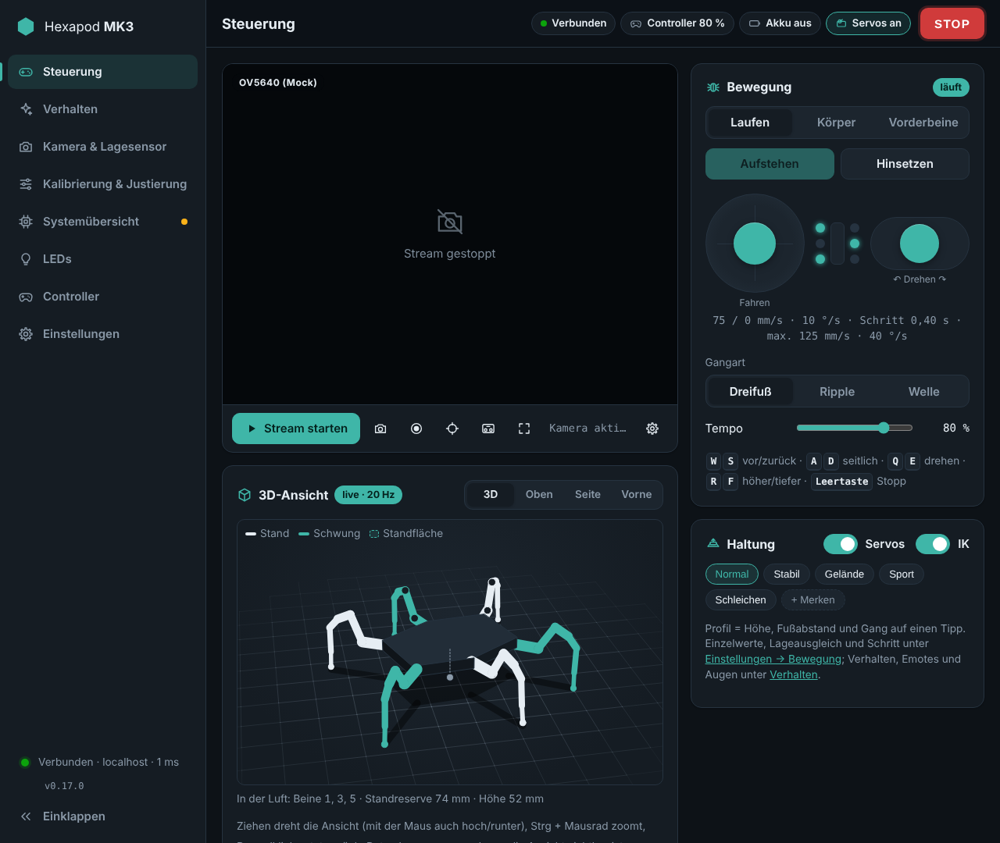
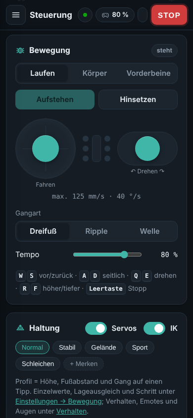
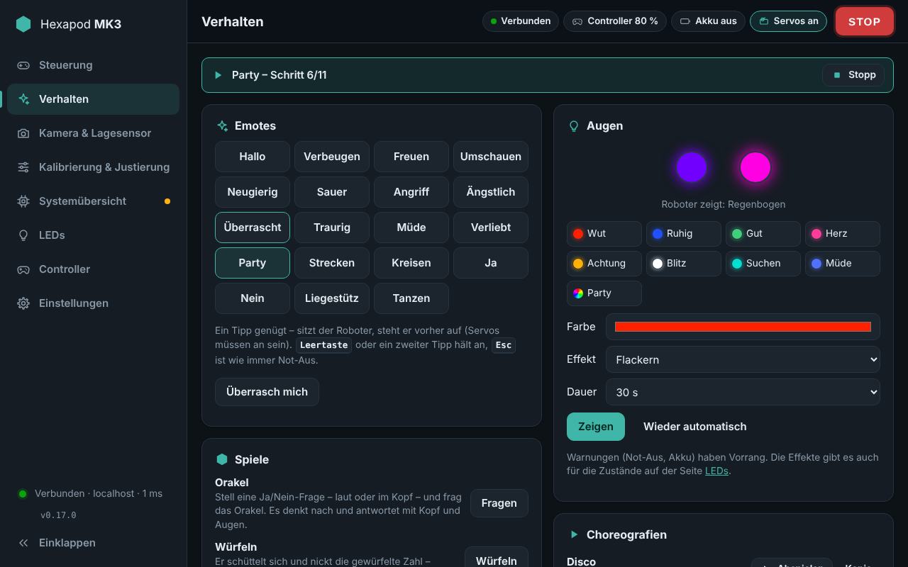
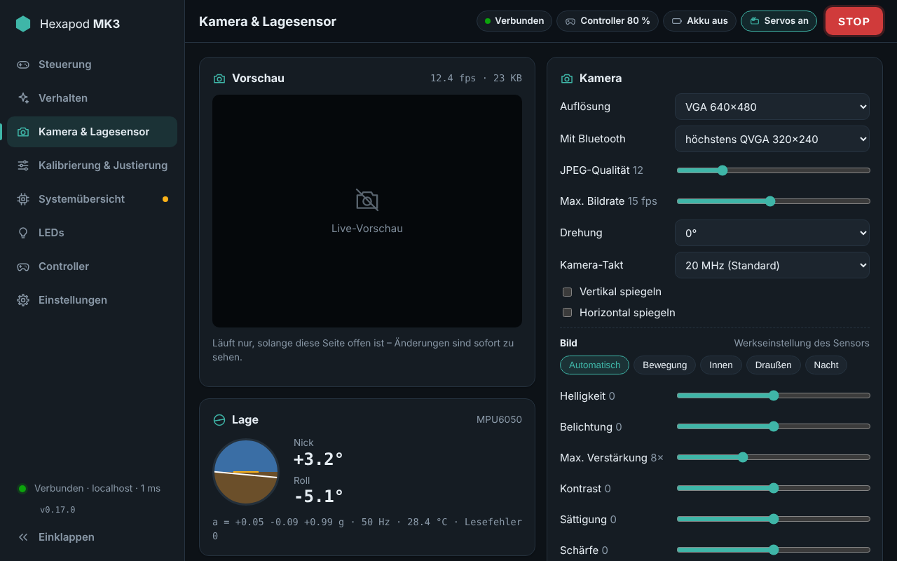
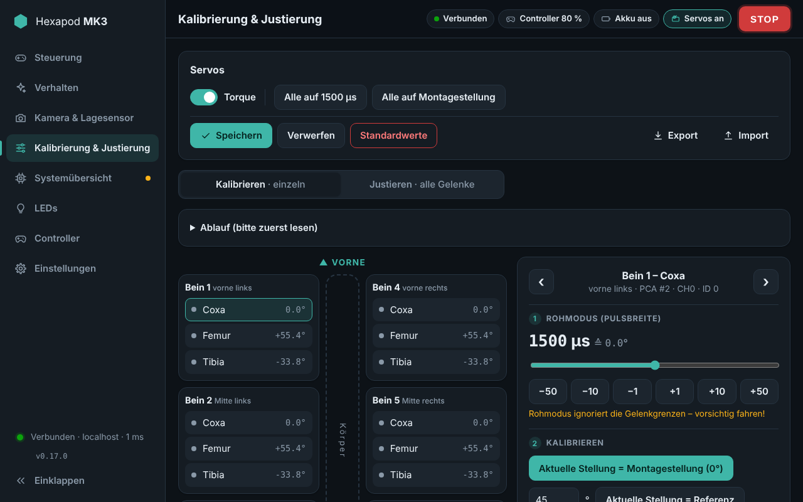
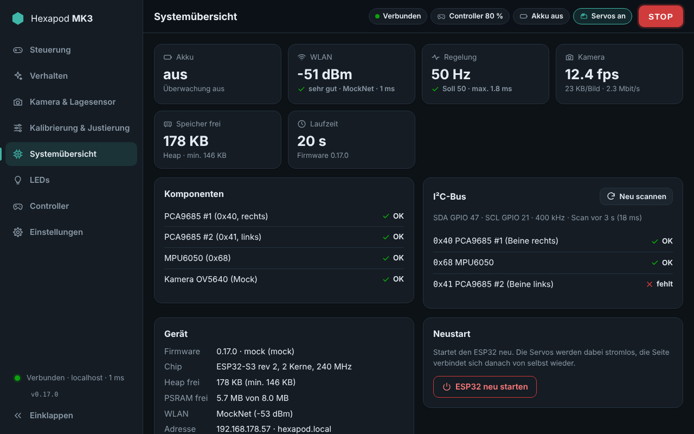
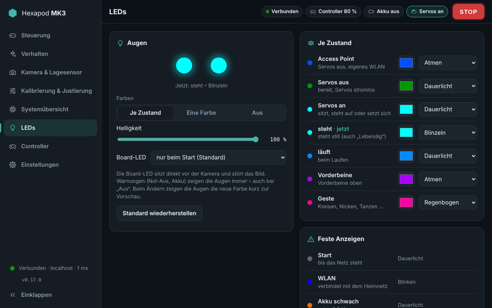
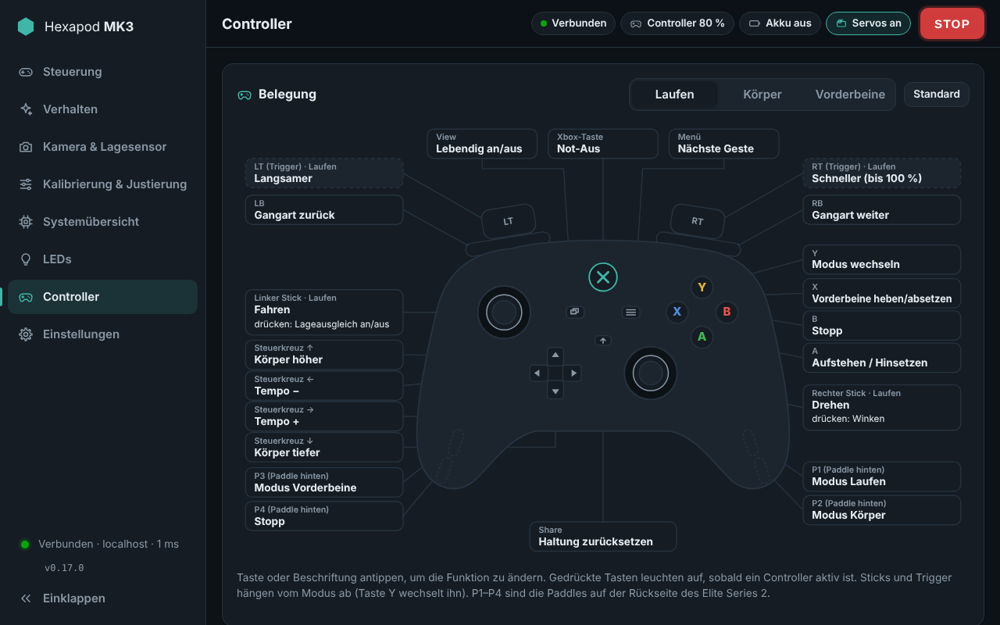
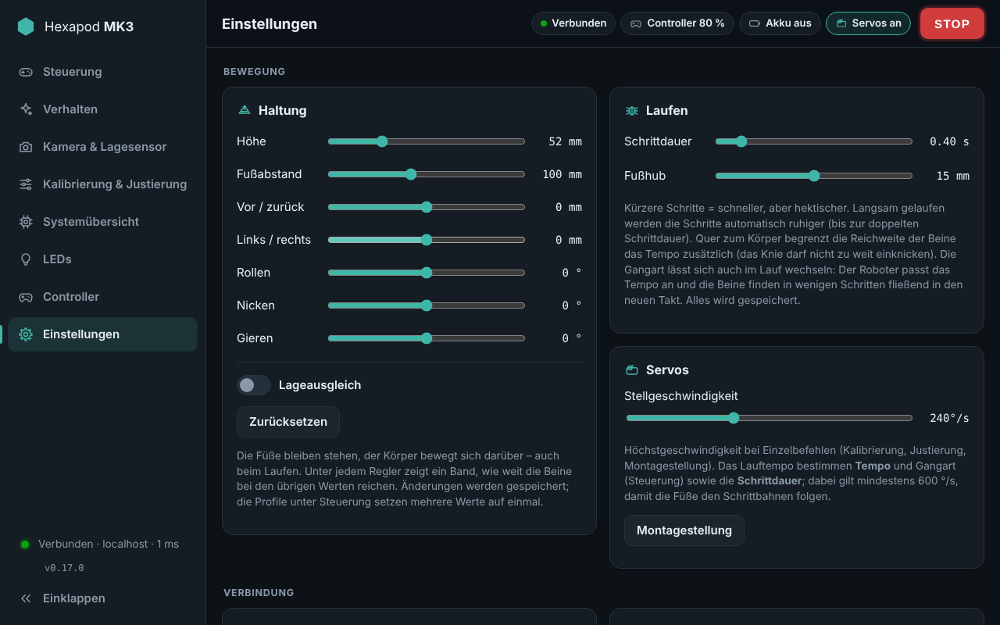

# Hexapod MK3

A 3D-printed six-legged robot with 18 servos, driven by an **ESP32-S3-CAM**. Inverse kinematics, three gaits,
a camera stream and a lot of personality – controlled from a web interface the robot serves itself (PC and
phone), or with an Xbox controller over Bluetooth.

<p align="center">
  
  
</p>

## Features

- **Walking** – inverse kinematics for all 18 joints, tripod / ripple / wave gait (switchable while walking),
  a climb gait with high box-shaped steps for carpet edges and thresholds,
  smooth foot paths, direction-dependent speed limits from the legs' real reach.
- **Posture** – height, stance, shift, roll, pitch, yaw; each slider shows its currently reachable range;
  IMU levelling; stand up / sit down; front-leg mode (lift, steer, wave); body joystick and gestures.
- **Personality** – emotes with animated eyes, games, a choreography editor, idle "alive" motions, breathing,
  boredom and falling asleep, wriggling when picked up, expressive walking (inertia, look-ahead, hip sway).
- **Camera** – MJPEG stream, zoom up to 4× and edge cropping (both on the OV5640 sensor, so real detail), photo and video
  recording in the browser, full-screen driver view with on-screen joysticks, artificial horizon.
- **Input** – touch joysticks, keyboard (WASD), Xbox (Elite) controller via Bluetooth on the robot or via the
  browser's Gamepad API; every button remappable.
- **Self-contained** – the UI is embedded in the firmware and needs no internet (works in access-point mode);
  installable as a home-screen app. UI in German or English (*Einstellungen → Oberfläche → Sprache / Language*).
- **Safe & maintainable** – E-stop (STOP / Esc), connection watchdog, battery protection, OTA updates,
  event log, live system metrics and history.

## Web interface

<table>
<tr>
<td width="50%" valign="top">
<b>Steuerung</b> (control)<br>
<a href="docs/images/ui-control.png"></a>
<ul>
<li>Camera stream with zoom, snapshot, video, horizon, driver view</li>
<li>Live 3D model (legs in the air, support polygon)</li>
<li>Joysticks for walking, body or front legs; gait and speed</li>
<li>Servo / IK switches, posture sliders (with the limiting joint shown), levelling, profiles</li>
</ul>
</td>
<td width="50%" valign="top">
<b>Verhalten</b> (behaviour)<br>
<a href="docs/images/ui-behavior.png"></a>
<ul>
<li>19 emotes (angry, attack, in love, party …) and games</li>
<li>Eye colours and effects, choreography editor with templates</li>
<li>Liveliness: idle motions, breathing, boredom/sleep, wriggling, gaze</li>
</ul>
</td>
</tr>
<tr>
<td valign="top">
<b>Kamera &amp; Lagesensor</b> (camera &amp; IMU)<br>
<a href="docs/images/ui-camera.png"></a>
<ul>
<li>Live preview and all camera settings (resolution, quality, presets, exposure …)</li>
<li>Attitude display, IMU mounting, zero point and gyro calibration</li>
</ul>
</td>
<td valign="top">
<b>Kalibrierung &amp; Justierung</b> (calibration)<br>
<a href="docs/images/ui-calibration.png"></a>
<ul>
<li>Guided per-servo calibration (centre, reference angle, limits)</li>
<li>Fine adjustment of all 18 joints, export / import</li>
</ul>
</td>
</tr>
<tr>
<td valign="top">
<b>Systemübersicht</b> (system)<br>
<a href="docs/images/ui-system.png"></a>
<ul>
<li>Battery, Wi-Fi, control loop, camera, memory at a glance</li>
<li>30-minute history, components, I²C scan, event log, reboot</li>
</ul>
</td>
<td valign="top">
<b>LEDs</b><br>
<a href="docs/images/ui-leds.png"></a>
<ul>
<li>Eye colour and effect per state (idle, standing, walking, gesture …)</li>
<li>Brightness, single colour or off, board LED</li>
</ul>
</td>
</tr>
<tr>
<td valign="top">
<b>Controller</b><br>
<a href="docs/images/ui-controller.png"></a>
<ul>
<li>Button map per mode, tap to remap, live input</li>
<li>Bluetooth pairing on the robot or browser gamepad; dead zone, curve</li>
</ul>
</td>
<td valign="top">
<b>Einstellungen</b> (settings)<br>
<a href="docs/images/ui-settings.png"></a>
<ul>
<li>Movement: step timing, foot lift, servo speed</li>
<li>Wi-Fi setup and signal meter, battery, firmware update, theme</li>
</ul>
</td>
</tr>
</table>

## Hardware

| Part | Type | Notes |
|---|---|---|
| Controller | ESP32-S3-CAM (N16R8) | 16 MB flash, 8 MB PSRAM, CH340 on the "TTL" USB port |
| Camera | OV5640 (OV2640 also detected) | sleeps without a stream (the OV5640 runs hot) |
| Servo drivers | 2× PCA9685 | `0x40` right legs 4–6, `0x41` (A0 bridged) left legs 1–3 |
| Servos | 18× MG90S | coxa / femur / tibia per leg |
| IMU | MPU6050 (GY-521) | `0x68` |
| Eyes | 2× WS2812B | GPIO 14 |
| Battery | 2S 18650 (6.0–8.4 V), 7.5 A fuse | no BMS – the firmware can protect the cells |
| Power | 2× UBEC 5 V (one per PCA9685), mini buck 5 V | logic and servos on separate supplies |

Main pins: I²C SDA 47 / SCL 21 (PCA9685, MPU6050), battery sense GPIO 1 (100 k / 47 k divider), eyes GPIO 14.
All pins live in [`firmware/include/config.h`](firmware/include/config.h). Wiring:
[`docs/hexapod_schaltplan_v4.png`](docs/hexapod_schaltplan_v4.png), details and servo mapping:
[`docs/hardware.md`](docs/hardware.md), leg geometry: [`docs/beingeometrie.png`](docs/beingeometrie.png).

## Installation

**1. Toolchain** – install [Git](https://git-scm.com/), [VS Code](https://code.visualstudio.com/) and the
**PlatformIO IDE** extension (or PlatformIO Core). On Windows enable long paths once (PowerShell as admin, then
reboot):

```powershell
New-ItemProperty -Path "HKLM:\SYSTEM\CurrentControlSet\Control\FileSystem" -Name "LongPathsEnabled" -Value 1 -PropertyType DWORD -Force
git config --global core.longpaths true
```

**2. Build and flash**

```bash
git clone https://github.com/Screase3D/Hexapod-MK3.git
cd Hexapod-MK3/firmware          # the folder with platformio.ini
pio run -t upload                # or ✓ / → in the VS Code status bar
```

- Main switch **SW1 off**, connect the **"TTL"** USB-C port. If the upload can't connect: hold **BOOT**,
  tap **RST**, release BOOT and retry.
- The first build downloads the ESP32 platform (~4 GB, 5–20 min); later builds take under a minute.
- No toolchain? Every push builds the firmware on GitHub: download the *hexapod-firmware* artifact from
  **Actions → Firmware** and flash `firmware.factory.bin` at `0x0` with
  [esptool-js](https://espressif.github.io/esptool-js/) (Chrome/Edge).

**3. First start**

1. Join the Wi-Fi **`Hexapod-MK3`** (password `hexapod123`); the UI opens as a captive portal or at
   `http://192.168.4.1`.
2. *Einstellungen → WLAN*: pick your home network (2.4 GHz) and connect. The robot then shows its new address;
   `http://hexapod.local` usually works too.
3. Unplug USB, switch SW1 on, calibrate the servos ([`docs/kalibrierung.md`](docs/kalibrierung.md), horn jig
   [`docs/montagelehre.pdf`](docs/montagelehre.pdf)).

Servos stay unpowered until the *Servos* switch is turned on; **STOP** or **Esc** is the E-stop. Battery
monitoring is off by default – enable it under *Einstellungen → Akku* once the voltage divider is fitted.

**4. Updates over Wi-Fi** – `pio run -e hexapod_ota -t upload`, or upload `firmware.bin` under
*Einstellungen → Firmware-Update*. Settings (calibration, Wi-Fi, posture …) survive updates.

## Development

```bash
cd firmware
pip install aiohttp && python tools/mock_server.py   # UI without the robot: http://localhost:8080
```

Host tests for kinematics, gaits, posture, behaviour, LEDs and controller live in
[`firmware/test_host/`](firmware/test_host); CI runs them and builds the firmware on every push
([`.github/workflows/firmware.yml`](.github/workflows/firmware.yml)).

Further documentation (German): [kinematics & gaits](docs/kinematik.md) ·
[calibration](docs/kalibrierung.md) · [hardware](docs/hardware.md) · [controller](docs/controller.md) ·
[API](docs/api.md) · [changelog](CHANGELOG.md)
