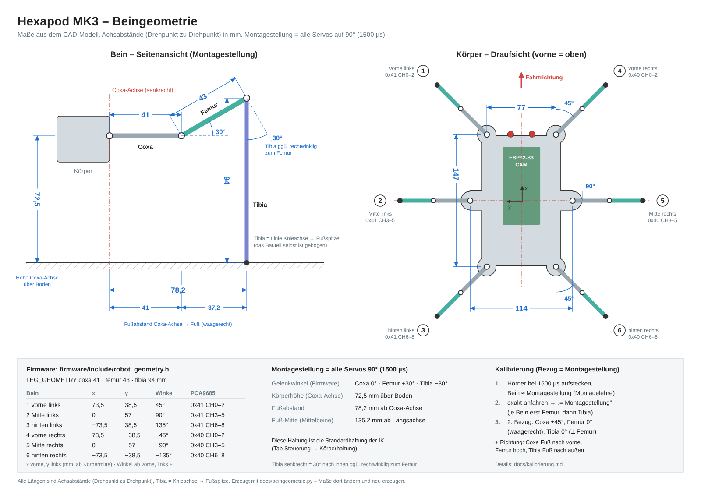

# Kinematics and body posture

The inverse kinematics (IK) computes the 18 joint angles from the desired foot positions. For this
to be correct on the real robot, it needs the **dimensions of the legs and their mounting points on the body**.
These are in [`firmware/include/robot_geometry.h`](../firmware/include/robot_geometry.h) and
come from the CAD model:



| | Value |
|---|---|
| Coxa / femur / tibia | 41 / 43 / 94 mm (axis to axis, tibia to foot tip) |
| Coxa axes front and rear | 77 mm apart, ±73.5 mm in front of/behind the center, leg angled at 45° |
| Coxa axes middle | 114 mm apart, leg at 90° to the side |
| Assembly pose (all servos 90°) | coxa 0°, femur +55.4°, tibia −33.8° (= default posture) |
| resulting standard posture | height 52 mm (femur axis above the foot tip), stance 100 mm, ground clearance approx. 28 mm |

The drawing is generated by [`beingeometrie.py`](beingeometrie.py)
(`python3 docs/beingeometrie.py`); if dimensions change, update them there and in `robot_geometry.h`.

### Assembly pose (servo center) = default posture

The servo horns are fitted at servo center (90° / 1500 µs) in the **default posture**,
which is also the pose the robot stands in. The height comes from the CAD (robot jacked up), but the foot tips
are 10 mm further inward than there (100 instead of 110 mm) – this relieves the femur by approx. 15 %:

| | Value |
|---|---|
| Femur | 55.4° above horizontal |
| Line knee axis → foot tip | 68.4° below horizontal, foot tip 34.6 mm outside the knee |
| Joint angles (firmware) | **coxa 0°, femur +55.4°, tibia −33.8°** (`ASSEMBLY_POSE`) |
| Height / stance | 52 mm (femur axis above the foot tip) / 100 mm |
| Chassis ground clearance | approx. 28 mm (underside 26 mm below the femur axis, round foot approx. 2 mm) |

The tibia part is curved: from the knee it first goes outward and then bends downward;
the foot tip sits roughly below this bend. For the IK, only the straight line from the
knee axis to the foot tip (94 mm) matters; the shape only plays a role for collisions.

The calibration uses this pose as its reference, and the standard posture of the web UI
matches it exactly. A printable jig: [montagelehre.pdf](montagelehre.pdf).

**Why this pose as servo center?** It lies in the middle of the working range – walking and sitting
stay within ±50° of it; only the fully raised body needs −65° at the femur
(default calibration limits ±70°, MG90S: about ±90°):

| Posture | Femur | Tibia | Inner knee |
|---|---|---|---|
| Default posture 52 / 100 mm | 55° (±0) | −34° (±0) | 56° |
| Walking (default values, all gaits) | 40…89° | −63…−8° | 27…82° |
| Foot raised 20 mm | 87° (+32) | −50° (−16) | 40° |
| Lying (sitting pose 23 / 100 mm) | 102° (+46) | −56° (−22) | 34° |
| Body high 80 / 100 mm | 17° (−39) | −6° (+28) | 84° |
| Body very high 100 / 100 mm | −10° (−65) | +20° (+54) | 110° |

“Inner knee” is the angle between the femur line and the line knee → foot tip (= 90° + tibia).
The pose is also easy to set up: a 1 mm error in height causes approx. 1.5° at the femur.

> **Check in CAD:** How far can the knee fold before the tibia part hits the femur
> or servo (while walking down to approx. 27°, with 20 mm foot lift 23°), and does the femur reach
> 102° (just past vertical) when sitting without colliding?

**Load:** The femur torque depends on the horizontal distance femur axis → foot (59 mm in the
default posture). At approx. 850 g and three supporting legs (tripod gait) this is about
1.7 kg·cm; with a 110 mm stance it would be 2 kg·cm, about as much as an MG90S can just barely hold.
Standing on six legs, it is half that. Even further inward (95 mm → approx. 1.5 kg·cm), the
knee has to fold even further when lifting the foot. If the femur becomes too weak while walking: ripple gait
(four legs carry the load). Best to weigh the finished robot once.

Prerequisite: the servos are calibrated ([kalibrierung.md](kalibrierung.md)), since the IK
uses the same joint angle conventions.

## Meaning of the dimensions

All dimensions in mm, each measured between the servos' **rotation axes** (center of the output shaft):

```
 Side view of a leg at 0° (femur horizontal, tibia at a right angle)

   Coxa axis      Femur axis           Knee axis
       │◄── coxa ──►│◄────── femur ──────►│
       ●────────────●━━━━━━━━━━━━━━━━━━━━●
                                         ┃
                                         ┃ tibia (to the foot tip)
                                         ┃
                                         ▼
```

| Value | Measurement |
|---|---|
| `coxa` | horizontal distance coxa rotation axis → femur rotation axis |
| `femur` | distance femur rotation axis → knee rotation axis |
| `tibia` | distance knee rotation axis → foot tip (contact point) |

Additionally, for **each of the 6 legs** (in `LEG_MOUNTS`):

| Value | Measurement |
|---|---|
| `x` | coxa rotation axis in front of (+) or behind (−) the body center |
| `y` | coxa rotation axis left (+) or right (−) of the body center |
| `angle_deg` | direction the leg points at coxa 0°: 0° = forward, 90° = left, −90° = right, ±180° = backward |

For a symmetric body, the values for one front leg, one middle leg and one
rear leg are sufficient; the right side then has `y` and `angle_deg` with the opposite sign. If the leg
has a height offset between the coxa and femur axes, or the tibia is strongly curved, please
report it – the model can be extended.

`GEOMETRY_IS_PLACEHOLDER = true` shows a warning in the web UI (for a
rebuild with dimensions not yet known).

The mounting angle of the corner legs (45°) is a convention: at coxa 0° the leg points exactly
diagonally; the calibration sets this up. If the angle on the body deviates significantly (e.g. because
the coxa servos are mounted at an angle), adjust `angle_deg` in `LEG_MOUNTS`.

## Coordinate systems

| System | Origin | Axes |
|---|---|---|
| World | ground below the body center (zero pose) | x forward, y left, z up |
| Body | body center at the height of the coxa axes | x forward, y left, z up |
| Leg | coxa axis | x in mounting direction, y 90° counterclockwise, z up |

## Body posture in the web UI

*Control* → **Posture** card → *IK* switch (the profiles are there too); the individual sliders are under
*Settings → Movement → Posture*. The feet stay at their standard points
(in mounting direction, at a distance of *Stance* from the coxa axis), and the body moves
above them:

| Slider | Meaning |
|---|---|
| Height | femur axes above the foot tips (35–100 mm, default 52) |
| Stance | distance foot ↔ coxa axis (horizontal, 75–135 mm, default 100) |
| Forward/back, Left/right | shift the body over the feet |
| Roll | + = right side down |
| Pitch | + = nose up |
| Yaw | + = turn left |

The posture follows the sliders at a limited speed (80 mm/s or 45 °/s,
`POSE_SPEED_*` in `robot_geometry.h`) and limited acceleration (400 mm/s² or 500 °/s²,
`POSE_ACCEL_*`): it starts smoothly and brakes in time before the target, without overshoot.
The servo ramps add a further limit.

**Unreachable posture:** The firmware checks every new posture before it takes effect
([`kin::checkPose`](../firmware/src/kinematics/kinematics.cpp)): do all feet reach the ground, and
do all joints stay within their calibration limits? If not, it takes the nearest permissible
posture on the way from the previous to the desired one (bisection) and reports exactly what was limited,
e.g. *“Posture limited: Height to 82 mm (wanted 100) – Legs 1, 3, 4, 6 can't reach the
ground”*. The web UI shows this as a notice in the Posture card, and the slider jumps back to
the actual value. This way the robot always stays mobile instead of getting
“stuck” in a posture from which it can no longer walk.

If the posture severely restricts the step length (body very high or low, feet very far inward or
outward), the *Movement* card reports: *“Leg reach limits the speed: forward 34 %,
sideways 20 %”*, or that walking is not possible at all in this posture.

Posture, gait parameters, levelling and servo speed are saved (NVS, 2 s after
the last change) and remain in effect after a restart; **Reset** restores the
standard posture. On a PC, **R**/**F** raise/lower the body in 5 mm steps.

**Profiles** (buttons above the sliders) set posture and gait with one click; shift and
tilt are reset to zero. All are reachable and suitable for walking (speed at 100 %):

| Profile | Height | Stance | Gait | Step duration | Foot lift | Forward speed |
|---|---|---|---|---|---|---|
| Normal | 52 mm | 100 mm | Tripod | 0.4 s | 15 mm | 175 mm/s |
| Stable | 42 mm | 115 mm | Ripple | 0.45 s | 12 mm | 78 mm/s |
| Terrain | 70 mm | 100 mm | Tripod | 0.5 s | 25 mm | 100 mm/s |
| Sport | 55 mm | 95 mm | Tripod | 0.3 s | 15 mm | 216 mm/s |
| Sneak | 45 mm | 105 mm | Wave | 0.5 s | 10 mm | 28 mm/s |
| Climb | 62 mm | 105 mm | Climb | 0.4 s | up to 45 mm (automatic) | 75 mm/s |

*+ Save* stores the current posture and gait as your own profile (up to four, in the browser).
The highlighted profile matches the current setting.

**First test:** jack the robot up (feet free), torque on, enable IK and change the height slowly.
All feet should move evenly and vertically. If a leg moves the wrong way,
its calibration (direction of rotation) or mounting angle is wrong.

<a id="lageausgleich"></a>

### Levelling

**Levelling** switch in the Posture card: the body stays level with the help of the attitude sensor
– or at the tilt set with *Roll*/*Pitch* –, even on sloping
ground ([`leveling.cpp`](../firmware/src/kinematics/leveling.cpp)). A controller adds up to ±15° per axis
to the commanded tilt: when standing with a time constant of 0.25 s (a 10° tilt is compensated after
approx. 0.7 s), when walking more calmly with approx. 0.7 s, so that it does not react to every
step. The correction changes by at most 30 °/s (the posture follows at 45 °/s; any faster
and the controller would run ahead and overshoot), dead band 0.5°. It only acts while standing and walking;
when standing up/sitting down the correction fades out. The attitude sensor itself is fast: the
complementary filter follows rotations immediately via the angular rate.

Prerequisite: the mounting orientation and zero point of the attitude sensor are correct (see
[kalibrierung.md](kalibrierung.md#lagesensor)). If the sensor is reversed, the controller would
amplify the tilt – if it detects this (correction at the limit, deviation stays large), it switches
itself off after approx. 2 s and the web UI reports it.

<a id="aufstehen-und-hinsetzen"></a>

## Standing up and sitting down

When torque is switched on, the legs move to the **sitting pose**: the body rests on the ground, the feet on
the ground at the same distance as when standing (100 mm, `SIT_STANCE`). This way the legs do not jerk
a robot lying on its belly upward.

When IK mode is switched on (*IK* switch, stand up, sit down), the firmware estimates the
actual posture from the current servo angles (forward kinematics, `estimateStance`): if the robot is sitting or
lying, IK mode starts in the sitting pose – it only stands up via **Stand up**. If it is already standing
(e.g. assembly pose), it continues at the measured height and the posture glides to the target. Until the
servos have reached the IK posture, they move at most 90 °/s. The IK state is saved and applies
again after a restart – without torque, it then starts in the sitting pose.

**Movement** card → **Stand up** ([`posture.cpp`](../firmware/src/kinematics/posture.cpp)):

1. raise the body smoothly to the set height (1.5 s, feet stay put),
2. if the standing stance differs from the sitting stance, reposition the feet with steps – do not
   push them under load. With the current values (both 100 mm) this step is skipped. Differences of up to
   10 mm would not be repositioned by the gait but pushed – so choose `SIT_STANCE` either equal
   or more than 10 mm different.

**Sit down** works the other way round: level the body, reposition the feet if necessary, then lower.
Walking is only possible while standing. Torque off or E-stop counts as “lying”: afterwards the
robot has to stand up again.

> `SIT_HEIGHT` in `robot_geometry.h` is the height of the femur axes above the foot tips when
> the body rests flat. According to the CAD, the chassis underside is 26 mm below the femur axis
> and the foot tip approx. 2 mm above the ground, i.e. approx. 24 mm; it is set to **23 mm**. Better
> slightly too small than too large: too small, and the feet hover just above the ground; too large,
> and they push the body up a little when switched on.

<a id="laufen"></a>

## Walking

First **Stand up** (see above). *Control* → **Movement** card → **Walk**: left joystick *Drive* (forward/back, sideways), right
*Turn*; on a PC also **W/S** (forward/back), **A/D** (sideways), **Q/E** (turn), **Space**
(stop). The joystick switches IK mode on; the body posture (height, tilt, …) remains in effect
while walking.

### How the gait works

[`src/kinematics/gait.cpp`](../firmware/src/kinematics/gait.cpp) guides the six feet
phase-controlled:

- **Stance phase:** The foot is on the ground. In the moving coordinate system it travels exactly
  opposite to the body movement (driving and turning) – so it does not slip.
- **Swing phase:** The foot lifts off, swings to a touchdown point ahead of the neutral position and
  sets down again. Height and forward swing follow profiles whose velocity is zero at the start and end
  (no jerk, no impact). The touchdown point is placed so that the following
  stance phase runs symmetrically around the neutral position.
- **Starting/stopping:** Accelerating takes at least 0.5 s or one stance phase (if the speed
  changes faster, a foot that has just touched down travels further than planned). When starting
  from standstill, the leg with the latest swing window travels along with the body until its first step;
  so that it does not end up much further inward than in normal walking
  (otherwise the knee folds too far), the gait accelerates more slowly in the first cycle
  (tripod 0.5 s, ripple approx. 1.4 s, wave approx. 2.4 s). Braking always takes 0.5 s. After releasing, the
  legs take one more step into the neutral position, then the robot stands; legs that are already
  there do not lift off.
- **Safety:** Without a new drive command for 0.6 s (`WALK_TIMEOUT_MS`, e.g. Wi-Fi lost, phone
  locked), without torque or on E-stop, the robot stops. The web UI also stops
  when the window loses focus.

| Gait | in the air simultaneously | Cycle (at 0.4 s step duration) | Forward speed | sideways |
|---|---|---|---|---|
| Tripod (`tripod`) | 3 (fl, rl, mr ↔ ml, fr, rr) | 0.8 s | 175 mm/s | 95 mm/s |
| Ripple (`ripple`) | 2 (one per side) | 1.2 s | 88 mm/s | 50 mm/s |
| Wave (`wave`) | 1 | 2.4 s | 35 mm/s | 21 mm/s |
| Climb (`climb`) | 3 (like tripod) | 1.6 s | 75 mm/s | 51 mm/s |

(Maximum values at 100 % speed, standard posture, 15 mm foot lift.)

**Climb** is for small obstacles such as carpet edges or thresholds: same pattern as tripod, but every
step is a **box trajectory** – the foot lifts almost vertically in the first 40 % of the swing, swings
forward only at the top and sets down vertically in the last 40 %. This way it does not bump
into the edge but steps over it. At the top it moves outward (15 mm, at least 10 mm beyond
its neutral point), otherwise the knee would fold too far with this much lift close to the body.
The **foot lift** adjusts itself: as high as possible (up to 45 mm, `gait::climbHeight`), as long as the knee
(`KNEE_MIN_DEG`) and femur (limit from the calibration, 3° margin) still fit even when a
corner leg is 20 mm toward the body while walking forward; in the standard posture this is 45 mm,
with a very low body less (at 35 mm only the normal foot lift; the web UI shows the value
below the joysticks),
the *Foot lift* slider applies to the other gaits. The swing takes twice as long (0.8 s at
0.4 s step duration, at least 0.7 s; joints stay below approx. 350 °/s), a step is at most 60 mm
long – forward 75 mm/s, a good two fifths of the tripod speed. For higher edges, raise the body (profile *Climb*: 62 mm, the chassis then has approx.
38 mm ground clearance). If you switch to or from Climb while walking, the robot stops briefly (the legs
go to the neutral position) and sets off again in the new gait – the steps are too
different for a smooth change of rhythm. The speed is limited by two things:

1. **Foot travel per stance phase** (70 mm, `GAIT_LIMITS.stride_max`) divided by the duration of the
   stance phase. Shorter step duration = faster. Ripple and wave are fundamentally
   slower: fewer legs swing at the same time, and the stance phase is two or five times as
   long as the swing – so the foot covers its 70 mm over a longer time. Faster would only be possible
   with a faster swing, and that is limited by the servos. With a high foot lift, the step is
   shorter (`gaitStrideMax`: from 15 mm lift, 2 mm less per mm, 50 mm at 25 mm), because the lifting
   alone already requires a lot of joint speed – this keeps all joints in the swing below approx.
   550 °/s (MG90S without load approx. 600 °/s).
2. **Reach** ([`gait::minFootRadius`](../firmware/src/kinematics/gait.cpp)): if a foot gets too close to the
   coxa axis, the knee has to fold a lot to lift it. The gait therefore calculates from
   body height, stance and foot lift how far inward a foot may go without the knee angle
   falling below `KNEE_MIN_DEG` (25°), and limits the speed **depending on direction**: forward,
   the middle legs swing across the leg and the corners diagonally – there the step length is sufficient;
   sideways, the middle legs move straight toward the body and are the limit. With a low body
   or high foot lift it becomes correspondingly slower (e.g. height 35 mm: sideways only approx. 35 mm/s).
   A 25 % reserve covers acceleration.

Driving and turning at the same time is limited so that no foot travels faster than allowed. The
web UI shows the currently possible maximum speed below the joysticks.

**Changing gait while walking:** Internally there is a common clock; each leg has an offset to it,
which in steady walking is exactly that of its pattern. When changing:

1. To a slower gait, the robot first smoothly brakes to its speed (the reach also has
   to fit with the longer stance phases); to a faster one, it switches rhythm immediately.
2. When switching rhythm, each stance leg is given the phase that matches its foot position (it lifts off when
   the foot reaches the rear end of the new stance phase). A swing in progress finishes at its
   speed at the planned touchdown point – no foot jumps.
3. Afterwards the legs settle into the new pattern during their stance phases: those that are behind stand up to 60 %
   shorter, those that are ahead up to 10 % longer (so the foot hardly travels further back). A
   common shift of all legs does not count – the pattern applies up to its position. Two neighboring
   legs never lift off at the same time. Until all legs are in rhythm (depending on the gaits approx. 2–7 s),
   the robot walks at 75 % of the speed of the slower gait, then accelerates smoothly.

The web UI shows “Gait changing …” below the joysticks while this is in progress.

**Edge of reach:** If a stance foot would leave the permitted range before its planned swing
(after a quick reversal of direction, when starting in curves), it repositions beforehand –
these legs first, after which the leg gets back into rhythm. If a foot lifts off close to the body and
does not swing outward right away, the swing trajectory takes it as far outward as the knee needs
at this height. In the randomized endurance test (gaits and drive commands wildly mixed), the
knee thus always stays above 25° – previously it folded down to 5° there.

**Step frequency adapts:** Walking slowly no longer means “the same number of steps, only shorter
ones”. If a step would be shorter than half the full step length, the gait
lengthens the step duration instead (up to twice the set value), smoothly with at most one
doubling per second. At 20 % speed the robot thus takes half as many steps (18 instead of
36 in 5 s) – this looks more natural, saves power and is easier on the servos. Full speed is still immediately
available: the permissible speed follows the current step duration, so when accelerating the
steps first get faster, then longer. The web UI shows the current step duration.

| Setting | Range | Default | Note |
|---|---|---|---|
| Speed | 10–100 % | 80 % | scales joystick and keys (web UI only) |
| Step duration | 0.3–1.2 s | 0.4 s | duration of one foot swing; shorter = faster, but more hectic |
| Foot lift | 5–25 mm | 15 mm | higher = slower across the body (knee) |

The *Servo speed* under Settings only applies to individual commands (calibration,
fine-tuning), not to walking: so that the servo ramp does not slow down the smooth step trajectories,
at least `GAIT_SERVO_SLEW_DEG_PER_S` (600 °/s, about what an MG90S manages without load) applies
in IK mode – only after the transition into the posture with the normal ramp has completed. With
the default values, the joints stay below approx. 350 °/s in the swing and below approx. 180 °/s when carrying;
the knee stays above 25°.

**First test:** jack the robot up (feet free), torque on, Stand up, speed at 20–30 %, Tripod, slowly
forward. You should see: three legs lifting alternately (front left, rear left, middle
right and vice versa), the feet on the ground moving evenly backward. Then on the ground,
slowly at first.

<a id="körper-bewegen-und-gesten"></a>

## Moving the body and gestures

**Movement** card → **Body**: the feet stay put, the joysticks only move the body –
left shifts (forward/back, sideways, up to ±30 mm: shift the center of gravity), right tilts
(pitch/roll up to ±12°); on a PC **W/A/S/D** shift, **Q/E** turn (yaw ±15°). Releasing
springs back to the set posture. Whatever the legs cannot reach is reverted
(notice *“At the reach limit”*).

**Gestures** (only while standing, short, smoothly faded in and out,
[`gestures.cpp`](../firmware/src/kinematics/gestures.cpp)):

| Gesture | Movement | Duration |
|---|---|---|
| Circle | body circles twice (±20 mm) | 6 s |
| Yes | nod three times (±9°) | 3.4 s |
| No | shake the head three times (yaw ±12°) | 3.4 s |
| Push-up | three times 22 mm down and back up | 5.6 s |
| Dance | sway the hips, bob and turn | 6.4 s |

*Stop*, walking or sitting down smoothly fade out a gesture from its current deflection. The
levelling does not counteract the gesture.

<a id="vorderbeine"></a>

## Front legs

**Movement** card → **Front legs** → **Raise front legs**
([`arms.cpp`](../firmware/src/kinematics/arms.cpp)). So that the robot does not tip forward,
this runs in statically stable steps:

1. **Shift weight** (1 s): body 35 mm backward, the middle legs step 25 mm
   forward. This puts the center of gravity safely inside the quadrilateral formed by the middle and rear legs.
2. **Raise** (1 s): the front feet lift off and move vertically to the ready position 60 mm above
   the ground.
3. **Control:** one joystick per leg, the foot follows the direction (seen from behind):
   ↑/↓ up/down (15–160 mm above the ground), ←/→ **swing** around the coxa (32° each: inward to
   almost straight ahead, outward far to the side). With *Mirrored*, the left joystick moves
   both legs as mirror images, and the right one's ↑/↓ extends them further or pulls them in
   (distance to the coxa approx. 87–162 mm). **Wave** raises the right leg high and swings it back and forth
   for 3 s.
4. **Lower**: back to the ready position, vertically down to the ground, then shift the weight back.

The workspace is not a fixed box: every target point is checked via IK (reachable, all joints
at least 3° inside the calibration limits, knee not below 25°). If the joystick asks for more than
the leg can give – e.g. all the way up **and** far out –, the firmware chooses the nearest reachable
distance to the coxa or stops at the edge (notice *“The leg can't reach that far”*). The feet
start and brake smoothly (up to 220 mm/s); if the reach cannot keep up, they slow down
instead of jumping. The front feet stay at least 80 mm apart and more than 60 mm away from the
middle feet (test).

While the front legs are up, walking is locked (the web UI says so); **Sit down**
lowers them automatically first. Before raising, the firmware checks whether the weight shift is reachable in the
current posture. In the test, the center of gravity stays at least 60 mm inside the support area
throughout the whole sequence.

**First test:** jacked up, then on the ground with your hand nearby – the values for weight shift,
ready position and range of motion are in `arms::Config`.

<a id="lebendig"></a>

## Alive

**Alive** switch on the *Behaviour* page, *Liveliness* card (on/off at any time, saved): when the
robot is standing still and nothing else is running, it moves very slightly now and then
([`alive.cpp`](../firmware/src/kinematics/alive.cpp)) – a random action every 2.5–7 s, never the
same one twice in a row:

| Action | Movement |
|---|---|
| Look around | body turns 7–13° to the side (nose slightly up), sometimes then to the other side |
| Shift weight | body 6–12 mm in a random direction, stays there for 1–3 s |
| Head tilt | roll 3–6°, nose up, turn slightly – “curious” |
| Lift leg | weight 5 mm away from one leg, lift that leg 14–22 mm, set it down again |
| Tap | a front leg taps impatiently two or three times |
| Re-set | lift all legs briefly one after another and put them down again |

In addition, it “breathes”: the body rises and falls by 1.2 mm every 4.5 s. At most one leg is ever
in the air, and the center of gravity stays at least 75 mm inside the support area (test). In postures
close to the limits, the movements become as much smaller as the legs require. Walking, body
joystick, gestures, front legs or sitting down fade it out in 0.4 s; afterwards it waits 2.5–4.5 s before
doing something again. The web UI shows next to the switch what it is currently doing.

<a id="lebendig-wirken"></a>

## Appearing alive

Independent of the *Alive* switch, individually on the *Behaviour* page, *Liveliness* card (saved, default: everything
on; [`life.cpp`](../firmware/src/kinematics/life.cpp)). The motion control applies all offsets only as far
as the legs allow in the current posture.

| Function | Behavior |
|---|---|
| Breathing | while standing, the body rises and falls by ±2 mm every 4.2 s (fades in/out over 1 s); the eyes dim by up to 22 % in rhythm. Replaces the slight breathing of *Alive* |
| Boredom | if it stands still and receives no input, it becomes bored after 40 % of the fall-asleep time (adjustable 2–30 min, default 5): yawns, then yawns, sighs or looks around every 18–35 s, eyes dimmed. After the fall-asleep time it yawns one last time and sits down – the eyes “sleep” in blue. Driving, body joystick, gestures, front legs or standing up wake it: it stands up and stretches. Other inputs (e.g. sitting down, changing the posture) wake it without it standing up |
| Wriggle when picked up | while standing (still or during “Alive”/yawning), it watches the attitude sensor. Three indicators: acceleration deviates from 1 g by more than 0.1 g, angular rate above 22 °/s (55 °/s during its own movements), or the measured tilt deviates by more than 6° from the intended body attitude (relative to a baseline tracked over 2 s – slopes and levelling do not interfere). Two to three cycles above the threshold (approx. 40–60 ms) mean “picked up”, a single bump never does. Sensitivity *low* (thresholds ×1.6), *medium*, *high* (×0.6). It then flails for 2.2 s, eyes flashing orange; only one group of three (as in the tripod) is ever in the air, so it stands safely even on a false detection. If you keep holding it in your hand, it wriggles again |
| Walking with character | Inertia: when starting, the body lags behind by up to 7 mm; when stopping, it swings forward and settles (spring 1.3 Hz). Looking ahead: in curves up to 9° into the direction of the turn, sideways up to 6° into the walking direction; forward, nose 2° down. Hip sway: ±1.6° roll and ±1.2 mm bob in step rhythm, stronger with speed. After walking for at least 2.5 s, it sometimes looks around when stopping |
| Eyes follow | when turning, walking sideways and with every yaw of the body (looking around, gestures), the eye on the other side dims by up to 75 % |

Yawning (head up to 14°, body 9–11 mm higher, then slump), sighing (deep breath in, sink down 12–15 mm)
and stretching (up to 19 mm high, arched back like a cat, then stretch both front legs forward 26 mm one after the
other) are *Alive* actions, but also run when the switch is off; their stability
is checked by a PC test.

## Tests

The math is hardware-independent and is tested on the PC, also in CI on every push:

- [`kinematics_test.cpp`](../firmware/test_host/kinematics_test.cpp): IK/FK, signs,
  body posture, standard posture = assembly pose
- [`gait_test.cpp`](../firmware/test_host/gait_test.cpp): stance legs do not slip, at most 3/2/1
  legs in the air at the same time, never two neighboring legs, no jumps, all foot points reachable and
  within the default limits (also at extreme values), knee angle not below `KNEE_MIN_DEG`,
  joint speeds, stopping and starting, foot deflection when starting; gait changes while
  walking for all pairs (straight, curve, sideways: speed glides, settled after < 8 s) and an
  endurance test with random changes and drive commands
- [`posture_test.cpp`](../firmware/test_host/posture_test.cpp): sitting pose reachable,
  standing up and sitting down fully computed (feet stay put while lifting, all positions
  reachable and within the limits)
- [`attitude_test.cpp`](../firmware/test_host/attitude_test.cpp): attitude sensor mounting orientations and
  signs, complementary filter, levelling (compensates tilts, detects wrong
  sensor direction)
- [`moves_test.cpp`](../firmware/test_host/moves_test.cpp): raise front legs, control them over the whole range,
  wave and lower (also aborting midway, in 17 body postures) – center of gravity always
  safely inside the support area, all positions reachable and within the limits, no jumps, no
  collision; gestures smooth, reachable and cleanly abortable; “Alive” for 10 min: all actions,
  calm, only one leg in the air, stable, fades out when walking

```
cd firmware/test_host
g++ -std=c++17 -I../src -I../include kinematics_test.cpp ../src/kinematics/kinematics.cpp -o kin_test
./kin_test
g++ -std=c++17 -I../src -I../include gait_test.cpp ../src/kinematics/gait.cpp ../src/kinematics/kinematics.cpp -o gait_test
./gait_test
g++ -std=c++17 -I../src -I../include posture_test.cpp ../src/kinematics/posture.cpp ../src/kinematics/gait.cpp ../src/kinematics/kinematics.cpp -o posture_test
./posture_test
g++ -std=c++17 -I../src -I../include attitude_test.cpp ../src/sensors/attitude.cpp ../src/kinematics/leveling.cpp -o attitude_test
./attitude_test
g++ -std=c++17 -I../src -I../include moves_test.cpp ../src/kinematics/arms.cpp ../src/kinematics/alive.cpp ../src/kinematics/gestures.cpp ../src/kinematics/gait.cpp ../src/kinematics/kinematics.cpp -o moves_test
./moves_test
```
