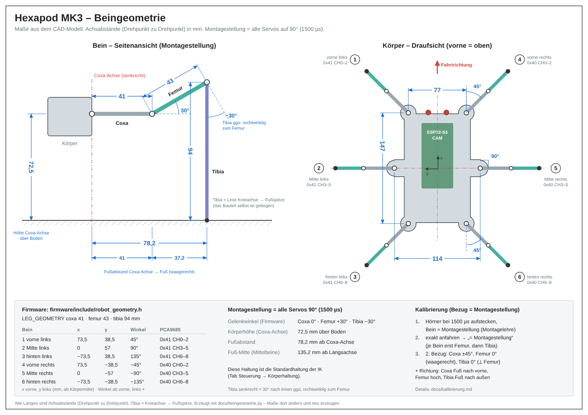

# Kinematik und Körperhaltung

Die inverse Kinematik (IK) rechnet aus gewünschten Fußpunkten die 18 Gelenkwinkel. Damit das
am echten Roboter stimmt, braucht sie die **Maße der Beine und ihre Montagepunkte am Körper**.
Diese stehen in [`firmware/include/robot_geometry.h`](../firmware/include/robot_geometry.h) und
stammen aus dem CAD-Modell:



| | Wert |
|---|---|
| Coxa / Femur / Tibia | 41 / 43 / 94 mm (Achse zu Achse, Tibia bis Fußspitze) |
| Coxa-Achsen vorne bzw. hinten | 77 mm auseinander, ±73,5 mm vor/hinter der Mitte, Bein 45° schräg |
| Coxa-Achsen Mitte | 114 mm auseinander, Bein 90° zur Seite |
| Montagestellung (alle Servos 90°) | Coxa 0°, Femur +55,4°, Tibia −33,8° (= Grundstellung) |
| daraus Standardhaltung | Höhe 52 mm (Femur-Achse über der Fußspitze), Fußabstand 100 mm, Bodenfreiheit ca. 28 mm |

Die Zeichnung wird von [`beingeometrie.py`](beingeometrie.py) erzeugt
(`python3 docs/beingeometrie.py`); ändern sich Maße, dort und in `robot_geometry.h` anpassen.

### Montagestellung (Servo-Mitte) = Grundstellung

Die Servohörner werden bei Servo-Mitte (90° / 1500 µs) in der **Grundstellung** aufgesteckt,
in der der Roboter auch steht. Die Höhe stammt aus dem CAD (Roboter aufgebockt), die Fußspitzen
stehen aber 10 mm weiter innen als dort (100 statt 110 mm) – das entlastet den Femur um ca. 15 %:

| | Wert |
|---|---|
| Femur | 55,4° über der Waagerechten |
| Linie Knieachse → Fußspitze | 68,4° unter der Waagerechten, Fußspitze 34,6 mm außerhalb des Knies |
| Gelenkwinkel (Firmware) | **Coxa 0°, Femur +55,4°, Tibia −33,8°** (`ASSEMBLY_POSE`) |
| Höhe / Fußabstand | 52 mm (Femur-Achse über der Fußspitze) / 100 mm |
| Bodenfreiheit Chassis | ca. 28 mm (Unterkante 26 mm unter der Femur-Achse, runder Fuß ca. 2 mm) |

Das Tibia-Bauteil ist gebogen: Vom Knie geht es erst nach außen und knickt dann nach unten ab,
die Fußspitze steht etwa unter diesem Knick. Für die IK zählt nur die gerade Linie von der
Knieachse zur Fußspitze (94 mm); die Form spielt nur für Anschläge eine Rolle.

Die Kalibrierung verwendet diese Stellung als Bezug, und die Standardhaltung der Oberfläche
entspricht ihr genau. Eine Lehre zum Ausdrucken: [montagelehre.pdf](montagelehre.pdf).

**Warum diese Stellung als Servo-Mitte?** Sie liegt mitten im Arbeitsbereich – Laufen und Sitzen
bleiben innerhalb von ±50° um sie, nur der ganz hoch gestellte Körper braucht −65° am Femur
(Standardgrenzen der Kalibrierung ±70°, MG90S: etwa ±90°):

| Haltung | Femur | Tibia | Knie innen |
|---|---|---|---|
| Grundstellung 52 / 100 mm | 55° (±0) | −34° (±0) | 56° |
| Laufen (Standardwerte, alle Gangarten) | 40…89° | −63…−8° | 27…82° |
| Fuß 20 mm angehoben | 87° (+32) | −50° (−16) | 40° |
| Liegen (Sitzhaltung 23 / 100 mm) | 102° (+46) | −56° (−22) | 34° |
| Körper hoch 80 / 100 mm | 17° (−39) | −6° (+28) | 84° |
| Körper sehr hoch 100 / 100 mm | −10° (−65) | +20° (+54) | 110° |

„Knie innen“ ist der Winkel zwischen Femur-Linie und Linie Knie → Fußspitze (= 90° + Tibia).
Außerdem ist die Stellung gut einzustellen: 1 mm Fehler in der Höhe macht ca. 1,5° am Femur.

> **Am CAD prüfen:** Wie weit lässt sich das Knie zuklappen, bevor das Tibia-Bauteil am Femur
> oder Servo anstößt (beim Laufen bis ca. 27°, mit 20 mm Fußhub 23°), und kommt der Femur im
> Sitzen auf 102° (knapp über senkrecht) ohne anzustoßen?

**Last:** Das Femur-Moment hängt vom waagerechten Abstand Femur-Achse → Fuß ab (in der
Grundstellung 59 mm). Bei ca. 850 g und drei tragenden Beinen (Dreifuß-Gang) sind das etwa
1,7 kg·cm; mit 110 mm Fußabstand wären es 2 kg·cm, so viel, wie ein MG90S gerade noch hält.
Im Stand auf sechs Beinen ist es die Hälfte. Noch weiter innen (95 mm → ca. 1,5 kg·cm) muss das
Knie beim Fußheben noch weiter einknicken. Wird der Femur beim Laufen zu schwach: Ripple-Gang
(vier Beine tragen). Am besten den fertigen Roboter einmal wiegen.

Voraussetzung: Die Servos sind kalibriert ([kalibrierung.md](kalibrierung.md)), denn die IK
verwendet dieselben Gelenkwinkel-Konventionen.

## Bedeutung der Maße

Alle Maße in mm, jeweils zwischen den **Drehachsen** der Servos (Mitte der Abtriebswelle):

```
 Seitenansicht eines Beins bei 0° (Femur waagerecht, Tibia rechtwinklig)

   Coxa-Achse     Femur-Achse          Knie-Achse
       │◄── coxa ──►│◄────── femur ──────►│
       ●────────────●━━━━━━━━━━━━━━━━━━━━●
                                         ┃
                                         ┃ tibia (bis zur Fußspitze)
                                         ┃
                                         ▼
```

| Wert | Messung |
|---|---|
| `coxa` | waagerechter Abstand Coxa-Drehachse → Femur-Drehachse |
| `femur` | Abstand Femur-Drehachse → Knie-Drehachse |
| `tibia` | Abstand Knie-Drehachse → Fußspitze (Aufsetzpunkt) |

Für **jedes der 6 Beine** zusätzlich (in `LEG_MOUNTS`):

| Wert | Messung |
|---|---|
| `x` | Coxa-Drehachse vor (+) bzw. hinter (−) der Körpermitte |
| `y` | Coxa-Drehachse links (+) bzw. rechts (−) der Körpermitte |
| `angle_deg` | Richtung, in die das Bein bei Coxa 0° zeigt: 0° = nach vorne, 90° = nach links, −90° = nach rechts, ±180° = nach hinten |

Bei einem symmetrischen Körper genügen die Werte für ein Bein vorne, eins in der Mitte und eins
hinten; die rechte Seite hat dann `y` und `angle_deg` mit umgekehrtem Vorzeichen. Hat das Bein
einen Höhenversatz zwischen Coxa- und Femur-Achse oder ist die Tibia stark gebogen, bitte
melden – das Modell lässt sich erweitern.

`GEOMETRY_IS_PLACEHOLDER = true` blendet in der Oberfläche einen Warnhinweis ein (für einen
Umbau mit noch unbekannten Maßen).

Der Montagewinkel der Eckbeine (45°) ist eine Festlegung: Bei Coxa 0° zeigt das Bein genau
diagonal, das stellt die Kalibrierung ein. Weicht der Winkel am Körper deutlich ab (z. B. weil
die Coxa-Servos schräg eingebaut sind), `angle_deg` in `LEG_MOUNTS` anpassen.

## Koordinatensysteme

| System | Ursprung | Achsen |
|---|---|---|
| Welt | Boden unter der Körpermitte (Nullpose) | x vorne, y links, z oben |
| Körper | Körpermitte auf Höhe der Coxa-Achsen | x vorne, y links, z oben |
| Bein | Coxa-Achse | x in Montagerichtung, y 90° gegen den Uhrzeigersinn, z oben |

## Körperhaltung in der Oberfläche

*Steuerung* → Karte **Haltung** → Schalter *IK* (dort auch die Profile); die einzelnen Regler stehen unter
*Einstellungen → Bewegung → Haltung*. Die Füße bleiben auf ihren Standardpunkten
(in Montagerichtung, im Abstand *Fußabstand* von der Coxa-Achse), der Körper bewegt sich
darüber:

| Regler | Bedeutung |
|---|---|
| Höhe | Femur-Achsen über den Fußspitzen (35–100 mm, Standard 52) |
| Fußabstand | Abstand Fuß ↔ Coxa-Achse (waagerecht, 75–135 mm, Standard 100) |
| Vor/zurück, Links/rechts | Körper über den Füßen verschieben |
| Rollen | + = rechte Seite runter |
| Nicken | + = Nase hoch |
| Gieren | + = nach links drehen |

Die Haltung folgt den Reglern mit begrenzter Geschwindigkeit (80 mm/s bzw. 45 °/s,
`POSE_SPEED_*` in `robot_geometry.h`) und begrenzter Beschleunigung (400 mm/s² bzw. 500 °/s²,
`POSE_ACCEL_*`): Sie fährt weich an und bremst rechtzeitig vor dem Ziel ab, ohne Überschwingen.
Zusätzlich begrenzen die Servo-Rampen.

**Unerreichbare Haltung:** Die Firmware prüft jede neue Haltung, bevor sie gilt
([`kin::checkPose`](../firmware/src/kinematics/kinematics.cpp)): Erreichen alle Füße den Boden, und
bleiben alle Gelenke innerhalb ihrer Kalibriergrenzen? Wenn nicht, nimmt sie die nächste zulässige
Haltung auf dem Weg von der bisherigen zur gewünschten (Bisektion) und meldet genau, was begrenzt
wurde, z. B. *„Haltung begrenzt: Höhe auf 82 mm (gewünscht 100) – Beine 1, 3, 4, 6 erreichen den Boden
nicht“*. Die Oberfläche zeigt das als Hinweis in der Karte Körperhaltung und der Regler springt auf
den tatsächlichen Wert zurück. So bleibt der Roboter immer beweglich, statt in einer Haltung zu
„hängen“, aus der er nicht mehr laufen kann.

Engt die Haltung die Schrittlänge stark ein (Körper sehr hoch oder tief, Füße sehr weit innen oder
außen), meldet die Karte *Bewegung*: *„Beinreichweite begrenzt das Tempo: vorwärts 34 %,
seitwärts 20 %“*, bzw. dass in dieser Haltung gar nicht gelaufen werden kann.

Haltung, Gangparameter, Lageausgleich und Stellgeschwindigkeit werden gespeichert (NVS, 2 s nach
der letzten Änderung) und gelten auch nach einem Neustart; **Zurücksetzen** stellt die
Standardhaltung wieder her. Am PC heben/senken **R**/**F** den Körper in 5-mm-Schritten.

**Profile** (Knöpfe über den Reglern) setzen Haltung und Gang auf einen Klick; Verschieben und
Neigen gehen dabei auf null. Alle sind erreichbar und zum Laufen geeignet (Tempo bei 100 %):

| Profil | Höhe | Fußabstand | Gangart | Schrittdauer | Fußhub | Tempo vorwärts |
|---|---|---|---|---|---|---|
| Normal | 52 mm | 100 mm | Dreifuß | 0,4 s | 15 mm | 175 mm/s |
| Stabil | 42 mm | 115 mm | Ripple | 0,45 s | 12 mm | 78 mm/s |
| Gelände | 70 mm | 100 mm | Dreifuß | 0,5 s | 25 mm | 100 mm/s |
| Sport | 55 mm | 95 mm | Dreifuß | 0,3 s | 15 mm | 216 mm/s |
| Schleichen | 45 mm | 105 mm | Welle | 0,5 s | 10 mm | 28 mm/s |

*+ Merken* speichert die aktuelle Haltung und Gangart als eigenes Profil (bis zu vier, im Browser).
Das markierte Profil entspricht der aktuellen Einstellung.

**Erster Test:** Roboter aufbocken (Füße frei), Torque an, IK aktivieren und Höhe langsam
ändern. Alle Füße sollten sich gleichmäßig senkrecht bewegen. Bewegt sich ein Bein falsch herum,
stimmt dessen Kalibrierung (Drehrichtung) oder Montagewinkel nicht.

### Lageausgleich

Schalter **Lageausgleich** in der Karte Körperhaltung: Der Körper bleibt mithilfe des Lagesensors
waagerecht – bzw. auf der mit *Rollen*/*Nicken* eingestellten Neigung –, auch auf schrägem
Untergrund ([`leveling.cpp`](../firmware/src/kinematics/leveling.cpp)). Ein Regler addiert je Achse
bis zu ±15° zur befohlenen Neigung: im Stand mit Zeitkonstante 0,25 s (10° Schräglage sind nach
ca. 0,7 s ausgeglichen), beim Laufen ruhiger mit ca. 0,7 s, damit er nicht auf jeden Schritt
reagiert. Die Korrektur ändert sich höchstens um 30 °/s (die Haltung folgt mit 45 °/s; schneller
würde der Regler vorauslaufen und überschwingen), Totzone 0,5°. Er wirkt nur im Stehen und Laufen;
beim Aufstehen/Hinsetzen baut sich die Korrektur ab. Der Lagesensor selbst ist schnell: Der
Komplementärfilter folgt Drehungen sofort über die Drehrate.

Voraussetzung: Einbaulage und Nullpunkt des Lagesensors stimmen (siehe
[kalibrierung.md](kalibrierung.md#lagesensor)). Dreht der Sensor falsch herum, würde der Regler
die Schräglage verstärken – erkennt er das (Korrektur am Anschlag, Abweichung bleibt groß), schaltet
er sich nach ca. 2 s ab und die Oberfläche meldet es.

## Aufstehen und Hinsetzen

Beim Einschalten von Torque fahren die Beine in die **Sitzhaltung**: Körper liegt auf, Füße auf
dem Boden im gleichen Abstand wie im Stand (100 mm, `SIT_STANCE`). So drücken die Beine einen auf
dem Bauch liegenden Roboter nicht ruckartig hoch.

Wird der IK-Betrieb eingeschaltet (Schalter *IK*, Aufstehen, Hinsetzen), schätzt die Firmware die
tatsächliche Haltung aus den aktuellen Servowinkeln (Vorwärtskinematik, `estimateStance`): Sitzt bzw.
liegt er, beginnt der IK-Betrieb im Sitzen – aufgestanden wird nur über **Aufstehen**. Steht er schon
(z. B. Montagestellung), geht es auf der gemessenen Höhe weiter und die Haltung gleitet zum Ziel. Bis die
Servos die IK-Haltung erreicht haben, fahren sie höchstens 90 °/s. Der IK-Zustand wird gespeichert und gilt
nach einem Neustart wieder – ohne Torque beginnt er dabei in der Sitzhaltung.

Karte **Bewegung** → **Aufstehen** ([`posture.cpp`](../firmware/src/kinematics/posture.cpp)):

1. Körper ruckfrei auf die eingestellte Höhe heben (1,5 s, Füße bleiben stehen),
2. weicht der Fußabstand im Stand von dem im Sitzen ab, die Füße mit Schritten umsetzen – nicht
   unter Last schieben. Mit den aktuellen Werten (beide 100 mm) entfällt das. Unterschiede bis
   10 mm würde die Gangart nicht umsetzen, sondern schieben – `SIT_STANCE` also entweder gleich
   oder mehr als 10 mm anders wählen.

**Hinsetzen** geht umgekehrt: Körper gerade ausrichten, ggf. Füße umsetzen, dann absenken.
Laufen ist nur im Stehen möglich. Torque aus oder Not-Aus gilt als „liegt“: Danach muss der
Roboter wieder aufstehen.

> `SIT_HEIGHT` in `robot_geometry.h` ist die Höhe der Femur-Achsen über den Fußspitzen, wenn
> der Körper flach aufliegt. Laut CAD liegt die Chassis-Unterkante 26 mm unter der Femur-Achse
> und die Fußspitze ca. 2 mm über dem Boden, also ca. 24 mm; eingestellt sind **23 mm**. Lieber
> etwas zu klein als zu groß: Zu klein, und die Füße schweben knapp über dem Boden; zu groß,
> und sie drücken den Körper beim Einschalten etwas hoch.

## Laufen

Erst **Aufstehen** (siehe oben). *Steuerung* → Karte **Bewegung** → **Laufen**: linker Joystick *Fahren* (vor/zurück, seitlich), rechter
*Drehen*; am PC auch **W/S** (vor/zurück), **A/D** (seitlich), **Q/E** (drehen), **Leertaste**
(Stopp). Der Joystick schaltet den IK-Modus ein; die Körperhaltung (Höhe, Neigung, …) gilt
beim Laufen weiter.

### Wie der Gang funktioniert

[`src/kinematics/gait.cpp`](../firmware/src/kinematics/gait.cpp) führt die sechs Füße
phasengesteuert:

- **Standphase:** Der Fuß steht auf dem Boden. Im mitlaufenden Koordinatensystem wandert er genau
  entgegen der Körperbewegung (Fahren und Drehen) – er rutscht also nicht.
- **Schwungphase:** Der Fuß hebt ab, schwingt zu einem Aufsetzpunkt vor der Neutralstellung und
  setzt wieder auf. Höhe und Vorschwung folgen Profilen, deren Geschwindigkeit am Anfang und Ende
  null ist (kein Ruck, kein Aufschlagen). Der Aufsetzpunkt liegt so, dass die folgende
  Standphase symmetrisch um die Neutralstellung verläuft.
- **Anfahren/Anhalten:** Beschleunigen dauert mindestens 0,5 s bzw. eine Standphase (ändert
  sich das Tempo schneller, wandert ein gerade aufgesetzter Fuß weiter als geplant). Beim Anlaufen
  aus dem Stillstand wandert das Bein mit dem spätesten Schwungfenster bis zu seinem ersten Schritt
  mit dem Körper mit; damit es dabei nicht viel weiter nach innen kommt als im normalen Lauf
  (sonst knickt das Knie zu weit ein), beschleunigt der Gang im ersten Zyklus langsamer
  (Dreifuß 0,5 s, Ripple ca. 1,4 s, Welle ca. 2,4 s). Bremsen geht immer in 0,5 s. Nach dem Loslassen machen die
  Beine noch einen Schritt in die Neutralstellung, dann steht der Roboter; Beine, die schon dort
  stehen, heben nicht ab.
- **Sicherheit:** Ohne neuen Fahrbefehl für 0,6 s (`WALK_TIMEOUT_MS`, z. B. WLAN weg, Handy
  gesperrt), ohne Torque oder bei Not-Aus hält der Roboter an. Die Oberfläche hält auch an,
  wenn das Fenster den Fokus verliert.

| Gangart | gleichzeitig in der Luft | Zyklus (bei 0,4 s Schrittdauer) | Tempo vorwärts | seitwärts |
|---|---|---|---|---|
| Dreifuß (`tripod`) | 3 (vl, hl, mr ↔ ml, vr, hr) | 0,8 s | 175 mm/s | 95 mm/s |
| Ripple (`ripple`) | 2 (je Seite eins) | 1,2 s | 88 mm/s | 50 mm/s |
| Welle (`wave`) | 1 | 2,4 s | 35 mm/s | 21 mm/s |

(Höchstwerte bei 100 % Tempo, Standardhaltung, 15 mm Fußhub.) Das Tempo begrenzen zwei Dinge:

1. **Fußweg je Standphase** (70 mm, `GAIT_LIMITS.stride_max`) geteilt durch die Dauer der
   Standphase. Kürzere Schrittdauer = schneller. Ripple und Welle sind dabei grundsätzlich
   langsamer: Es schwingen weniger Beine gleichzeitig, die Standphase ist zwei- bzw. fünfmal so
   lang wie der Schwung – der Fuß legt seine 70 mm also in längerer Zeit zurück. Schneller ginge
   nur mit schnellerem Schwung, und den begrenzen die Servos. Bei hohem Fußhub ist der Schritt
   kürzer (`gaitStrideMax`: ab 15 mm Hub je mm 2 mm weniger, bei 25 mm 50 mm), weil schon das
   Anheben viel Gelenkgeschwindigkeit braucht – so bleiben alle Gelenke im Schwung unter ca.
   550 °/s (MG90S ohne Last ca. 600 °/s).
2. **Reichweite** ([`gait::minFootRadius`](../firmware/src/kinematics/gait.cpp)): Kommt ein Fuß der
   Coxa-Achse zu nahe, muss das Knie zum Anheben weit einknicken. Die Gangart rechnet deshalb aus
   Körperhöhe, Fußabstand und Fußhub, wie weit ein Fuß nach innen darf, ohne dass der Kniewinkel
   unter `KNEE_MIN_DEG` (25°) fällt, und begrenzt das Tempo **richtungsabhängig**: Vorwärts
   schwingen die Mittelbeine quer zum Bein und die Ecken schräg – dort reicht die Schrittlänge;
   seitwärts bewegen sich die Mittelbeine genau zum Körper hin und begrenzen. Bei tiefem Körper
   oder hohem Fußhub wird es entsprechend langsamer (z. B. Höhe 35 mm: seitwärts nur ca. 35 mm/s).
   25 % Reserve decken das Beschleunigen ab.

Fahren und Drehen gleichzeitig wird so begrenzt, dass kein Fuß schneller als erlaubt wandert. Die
Oberfläche zeigt das aktuell mögliche Höchsttempo unter den Joysticks.

**Gangart im Lauf wechseln:** Intern läuft ein gemeinsamer Takt; jedes Bein hat einen Versatz dazu,
im eingeschwungenen Lauf genau den seines Musters. Beim Wechsel:

1. Zu einer langsameren Gangart bremst der Roboter erst gleitend auf deren Tempo ab (auch die
   Reichweite muss bei den längeren Standphasen passen), zu einer schnelleren taktet er sofort um.
2. Beim Umtakten bekommt jedes Standbein die Phase, die zu seiner Fußstellung passt (es hebt ab, wenn
   der Fuß das hintere Ende der neuen Standphase erreicht). Ein laufender Schwung endet in seinem
   Tempo am geplanten Aufsetzpunkt – kein Fuß springt.
3. Danach finden die Beine in ihren Standphasen ins neue Muster: Wer hinterher ist, steht bis zu 60 %
   kürzer, wer voraus ist, bis zu 10 % länger (der Fuß wandert so kaum weiter nach hinten). Eine
   gemeinsame Verschiebung aller Beine zählt nicht – das Muster gilt bis auf seine Lage. Nie heben
   zwei Nachbarbeine gleichzeitig ab. Bis alle Beine im Takt sind (je nach Gangarten ca. 2–7 s),
   läuft der Roboter mit 75 % des Tempos der langsameren Gangart, dann beschleunigt er gleitend.

Die Oberfläche zeigt „Gangart wechselt …“ unter den Joysticks, solange das läuft.

**Rand der Reichweite:** Würde ein Standfuß vor seinem geplanten Schwung den erlaubten Bereich
verlassen (nach einer schnellen Richtungsumkehr, beim Anlaufen in Kurven), setzt er vorher um –
diese Beine zuerst, danach findet das Bein wieder in den Takt. Hebt ein Fuß nah am Körper ab und
schwingt nicht gleich nach außen, führt die Schwungbahn ihn so weit nach außen, wie das Knie in
dieser Höhe braucht. Im Zufalls-Dauertest (Gangarten und Fahrbefehle wild durcheinander) bleibt das
Knie so immer über 25° – vorher knickte es dort bis auf 5° ein.

**Schrittfrequenz passt sich an:** Langsam laufen heißt nicht mehr „gleich viele, nur kürzere
Schritte“. Wäre ein Schritt kürzer als die Hälfte der vollen Schrittlänge, verlängert die Gangart
stattdessen die Schrittdauer (bis zum Doppelten der eingestellten), gleitend mit höchstens einer
Verdopplung pro Sekunde. Bei 20 % Tempo macht der Roboter so halb so viele Schritte (in 5 s 18 statt
36) – das sieht natürlicher aus, spart Strom und schont die Servos. Volles Tempo ist dabei sofort
verfügbar: Das zulässige Tempo folgt der aktuellen Schrittdauer, beim Beschleunigen werden die
Schritte also erst schneller, dann länger. Die Oberfläche zeigt die aktuelle Schrittdauer an.

| Einstellung | Bereich | Standard | Hinweis |
|---|---|---|---|
| Tempo | 10–100 % | 80 % | skaliert Joystick und Tasten (nur in der Oberfläche) |
| Schrittdauer | 0,3–1,2 s | 0,4 s | Dauer eines Fußschwungs; kürzer = schneller, aber hektischer |
| Fußhub | 5–25 mm | 15 mm | höher = langsamer quer zum Körper (Knie) |

Die *Stellgeschwindigkeit* unter Einstellungen wirkt nur bei Einzelbefehlen (Kalibrierung,
Justierung), nicht beim Laufen: Damit die Servo-Rampe die glatten Schrittbahnen nicht ausbremst, gilt
im IK-Betrieb mindestens `GAIT_SERVO_SLEW_DEG_PER_S` (600 °/s, etwa das, was ein MG90S ohne Last
schafft) – erst, nachdem der Übergang in die Haltung mit der normalen Rampe abgeschlossen ist. Bei
den Standardwerten bleiben die Gelenke im Schwung unter ca. 350 °/s, beim Tragen unter ca. 180 °/s;
das Knie bleibt über 25°.

**Erster Test:** Roboter aufbocken (Füße frei), Torque an, Aufstehen, Tempo auf 20–30 %, Dreifuß, langsam
nach vorne. Zu sehen sein sollte: abwechselnd drei Beine heben (vorne links, hinten links, Mitte
rechts und umgekehrt), die Füße am Boden wandern gleichmäßig nach hinten. Danach auf dem Boden,
zuerst langsam.

## Körper bewegen und Gesten

Karte **Bewegung** → **Körper**: Die Füße bleiben stehen, die Joysticks bewegen nur den Körper –
links verschieben (vor/zurück, seitlich, bis ±30 mm: Schwerpunkt verlagern), rechts neigen
(Nicken/Rollen bis ±12°); am PC **W/A/S/D** verschieben, **Q/E** drehen (Gieren ±15°). Loslassen
federt in die eingestellte Haltung zurück. Was die Beine nicht erreichen, wird zurückgenommen
(Hinweis *„An der Reichweitengrenze“*).

**Gesten** (nur im Stand, kurz, weich ein- und ausgeblendet,
[`gestures.cpp`](../firmware/src/kinematics/gestures.cpp)):

| Geste | Bewegung | Dauer |
|---|---|---|
| Kreisen | Körper kreist zweimal (±20 mm) | 6 s |
| Ja | dreimal nicken (±9°) | 3,4 s |
| Nein | dreimal den Kopf schütteln (Gieren ±12°) | 3,4 s |
| Liegestütz | dreimal 22 mm tief und wieder hoch | 5,6 s |
| Tanzen | Hüften schwingen, wippen und drehen | 6,4 s |

*Stopp*, Laufen oder Hinsetzen blenden eine Geste aus dem aktuellen Ausschlag weich aus. Der
Lageausgleich regelt nicht gegen die Geste.

## Vorderbeine

Karte **Bewegung** → **Vorderbeine** → **Vorderbeine heben**
([`arms.cpp`](../firmware/src/kinematics/arms.cpp)). Damit der Roboter dabei nicht nach vorne kippt,
läuft das statisch stabil in Schritten ab:

1. **Gewicht verlagern** (1 s): Körper 35 mm nach hinten, die Mittelbeine setzen mit Schritten 25 mm
   nach vorne. Damit steht der Schwerpunkt sicher im Viereck aus Mittel- und Hinterbeinen.
2. **Heben** (1 s): Die Vorderfüße lösen sich und gehen senkrecht in die Bereitstellung 60 mm über
   dem Boden.
3. **Steuern:** Je ein Joystick pro Bein, der Fuß folgt der Richtung (von hinten gesehen):
   ↑/↓ hoch/runter (15–160 mm über dem Boden), ←/→ **schwenken** um die Coxa (je 32°: nach innen bis
   fast geradeaus nach vorne, nach außen weit zur Seite). Mit *Gespiegelt* bewegt der linke Joystick
   beide Beine spiegelbildlich, der rechte ↑/↓ streckt sie weiter aus bzw. zieht sie heran
   (Abstand zur Coxa ca. 87–162 mm). **Winken** hebt das rechte Bein hoch und schwenkt es 3 s hin
   und her.
4. **Absetzen**: zurück in die Bereitstellung, senkrecht auf den Boden, dann Gewicht zurück.

Der Arbeitsraum ist kein fester Kasten: Jeder Zielpunkt wird per IK geprüft (erreichbar, alle Gelenke
mindestens 3° innerhalb der Kalibriergrenzen, Knie nicht unter 25°). Wünscht der Joystick mehr, als
das Bein hergibt – z. B. ganz hoch **und** weit weg –, wählt die Firmware den nächsten erreichbaren
Abstand zur Coxa bzw. bleibt am Rand stehen (Hinweis *„So weit reicht das Bein nicht“*). Die Füße
fahren weich an und bremsen (bis 220 mm/s), kommt die Reichweite nicht hinterher, werden sie langsamer
statt zu springen. Die Vorderfüße bleiben dabei mindestens 80 mm auseinander und über 60 mm von den
Mittelfüßen entfernt (Test).

Solange die Vorderbeine oben sind, ist Laufen gesperrt (die Oberfläche sagt das); **Hinsetzen**
setzt sie vorher automatisch ab. Vor dem Heben prüft die Firmware, ob die Gewichtsverlagerung in der
aktuellen Haltung erreichbar ist. Im Test bleibt der Schwerpunkt während des ganzen Ablaufs mindestens
60 mm innerhalb der Standfläche.

**Erster Test:** aufgebockt, dann am Boden mit der Hand in der Nähe – die Werte für Gewichtsverlagerung,
Bereitstellung und Bewegungsbereich stehen in `arms::Config`.

## Lebendig

Schalter **Lebendig** auf der Seite *Verhalten*, Karte *Lebendigkeit* (jederzeit an/aus, wird gespeichert): Steht der
Roboter still und läuft sonst nichts, bewegt er sich ab und zu ganz leicht
([`alive.cpp`](../firmware/src/kinematics/alive.cpp)) – alle 2,5–7 s eine zufällige Aktion, nie zweimal
dieselbe hintereinander:

| Aktion | Bewegung |
|---|---|
| Umschauen | Körper dreht 7–13° zur Seite (Nase etwas hoch), manchmal danach zur anderen |
| Gewicht verlagern | Körper 6–12 mm in eine zufällige Richtung, bleibt 1–3 s so |
| Kopf schief | rollen 3–6°, Nase hoch, leicht drehen – „neugierig“ |
| Bein heben | Gewicht 5 mm weg von einem Bein, das Bein 14–22 mm anheben, wieder absetzen |
| Tippen | ein Vorderbein tippt zwei-, dreimal ungeduldig auf |
| Neu setzen | alle Beine nacheinander kurz anheben und wieder hinstellen |

Dazu „atmet“ er: Der Körper hebt und senkt sich alle 4,5 s um 1,2 mm. Es ist immer höchstens ein Bein
in der Luft, der Schwerpunkt bleibt mindestens 75 mm innerhalb der Standfläche (Test). In Haltungen
nahe an den Grenzen fallen die Bewegungen so viel kleiner aus, wie die Beine erlauben. Laufen, Körper-
Joystick, Gesten, Vorderbeine oder Hinsetzen blenden ihn in 0,4 s aus; danach wartet er 2,5–4,5 s, bevor
er wieder etwas tut. Die Oberfläche zeigt neben dem Schalter, was er gerade macht.

## Lebendig wirken

Unabhängig vom Schalter *Lebendig*, einzeln auf der Seite *Verhalten*, Karte *Lebendigkeit* (gespeichert, Standard: alles
an; [`life.cpp`](../firmware/src/kinematics/life.cpp)). Alle Versätze wendet die Bewegungssteuerung nur so weit
an, wie die Beine es in der aktuellen Haltung erlauben.

| Funktion | Verhalten |
|---|---|
| Atmen | im Stand hebt und senkt sich der Körper alle 4,2 s um ±2 mm (blendet in 1 s ein/aus); die Augen werden im Takt bis zu 22 % dunkler. Ersetzt das leichte Atmen von *Lebendig* |
| Langeweile | steht er still und kommt keine Eingabe, wird er nach 40 % der Einschlafzeit (einstellbar 2–30 min, Standard 5) gelangweilt: gähnt, danach alle 18–35 s gähnen, seufzen oder umschauen, Augen gedimmt. Nach der Einschlafzeit gähnt er ein letztes Mal und setzt sich hin – die Augen „schlafen“ blau. Fahren, Körper-Joystick, Gesten, Vorderbeine oder Aufstehen wecken ihn: er steht auf und streckt sich. Andere Eingaben (z. B. Hinsetzen, Haltung ändern) wecken ihn, ohne dass er aufsteht |
| Zappeln beim Hochheben | steht er (still oder bei „Lebendig“/Gähnen), achtet er auf den Lagesensor. Drei Hinweise: Beschleunigung weicht um mehr als 0,1 g von 1 g ab, Drehrate über 22 °/s (während eigener Bewegungen 55 °/s), oder die gemessene Neigung weicht um mehr als 6° von der gewollten Körperlage ab (gegenüber einer in 2 s nachgeführten Grundlinie – Schräge und Lageausgleich stören nicht). Zwei bis drei Takte über der Schwelle (ca. 40–60 ms) heißen „hochgehoben“, ein einzelner Stoß nie. Empfindlichkeit *gering* (Schwellen ×1,6), *mittel*, *hoch* (×0,6). Dann strampelt er 2,2 s, Augen orange blitzend; immer nur eine Dreiergruppe (wie beim Tripod) in der Luft, er steht also auch bei einer Fehlerkennung sicher. Hält man ihn weiter in der Hand, zappelt er erneut |
| Laufen mit Charakter | Trägheit: beim Anfahren bleibt der Körper bis 7 mm zurück, beim Anhalten schwingt er nach vorne und pendelt sich ein (Feder 1,3 Hz). Blick voraus: in Kurven bis 9° in die Drehrichtung, seitwärts bis 6° in die Laufrichtung; vorwärts Nase 2° runter. Hüftschwung: ±1,6° rollen und ±1,2 mm wippen im Schritttakt, stärker mit dem Tempo. Nach mindestens 2,5 s Laufen schaut er sich beim Anhalten manchmal um |
| Augen schauen mit | beim Drehen, Seitwärtslaufen und bei jedem Gieren des Körpers (Umschauen, Gesten) wird das Auge auf der anderen Seite bis zu 75 % dunkler |

Gähnen (Kopf bis 14° hoch, Körper 9–11 mm höher, dann zusammensacken), Seufzen (tief einatmen, 12–15 mm
zusammensinken) und Strecken (bis 19 mm hoch, Katzenbuckel, dann beide Vorderbeine nacheinander 26 mm nach
vorne strecken) sind Aktionen von *Lebendig*, laufen aber auch, wenn der Schalter aus ist; die Standsicherheit
prüft ein PC-Test.

## Tests

Die Mathematik ist hardwareunabhängig und wird auf dem PC getestet, auch in der CI bei jedem Push:

- [`kinematics_test.cpp`](../firmware/test_host/kinematics_test.cpp): IK/FK, Vorzeichen,
  Körperhaltung, Standardhaltung = Montagestellung
- [`gait_test.cpp`](../firmware/test_host/gait_test.cpp): Standbeine rutschen nicht, höchstens 3/2/1
  Beine gleichzeitig in der Luft, nie zwei Nachbarbeine, keine Sprünge, alle Fußpunkte erreichbar und
  innerhalb der Standardgrenzen (auch bei Extremwerten), Kniewinkel nicht unter `KNEE_MIN_DEG`,
  Gelenkgeschwindigkeiten, Anhalten und Anfahren, Auslenkung der Füße beim Anlaufen; Gangwechsel im
  Lauf für alle Paare (geradeaus, Kurve, seitwärts: Tempo gleitet, eingeschwungen nach < 8 s) und ein
  Dauertest mit zufälligen Wechseln und Fahrbefehlen
- [`posture_test.cpp`](../firmware/test_host/posture_test.cpp): Sitzhaltung erreichbar,
  Aufstehen und Hinsetzen komplett durchgerechnet (Füße bleiben beim Heben stehen, alle Stellungen
  erreichbar und innerhalb der Grenzen)
- [`attitude_test.cpp`](../firmware/test_host/attitude_test.cpp): Lagesensor-Einbaulagen und
  Vorzeichen, Komplementärfilter, Lageausgleich (gleicht Schräglagen aus, erkennt falsche
  Sensorrichtung)
- [`moves_test.cpp`](../firmware/test_host/moves_test.cpp): Vorderbeine heben, im ganzen Bereich
  steuern, winken und absetzen (auch Abbruch mittendrin, in 17 Körperhaltungen) – Schwerpunkt immer
  sicher in der Standfläche, alle Stellungen erreichbar und in den Grenzen, keine Sprünge, keine
  Kollision; Gesten weich, erreichbar und sauber abbrechbar; „Lebendig“ 10 min lang: alle Aktionen,
  ruhig, nur ein Bein in der Luft, stabil, Ausblenden beim Laufen

```
cd firmware/test_host
g++ -std=c++17 -I../src -I../include kinematics_test.cpp ../src/kinematics/kinematics.cpp -o kin_test
./kin_test
g++ -std=c++17 -I../src -I../include gait_test.cpp ../src/kinematics/gait.cpp ../src/kinematics/kinematics.cpp -o gait_test
./gait_test
g++ -std=c++17 -I../src -I../include posture_test.cpp ../src/kinematics/posture.cpp ../src/kinematics/gait.cpp ../src/kinematics/kinematics.cpp -o posture_test
./posture_test
g++ -std=c++17 -I../src -I../include attitude_test.cpp ../src/sensors/attitude.cpp ../src/kinematics/leveling.cpp -o attitude_test
./attitude_test
g++ -std=c++17 -I../src -I../include moves_test.cpp ../src/kinematics/arms.cpp ../src/kinematics/alive.cpp ../src/kinematics/gestures.cpp ../src/kinematics/gait.cpp ../src/kinematics/kinematics.cpp -o moves_test
./moves_test
```
